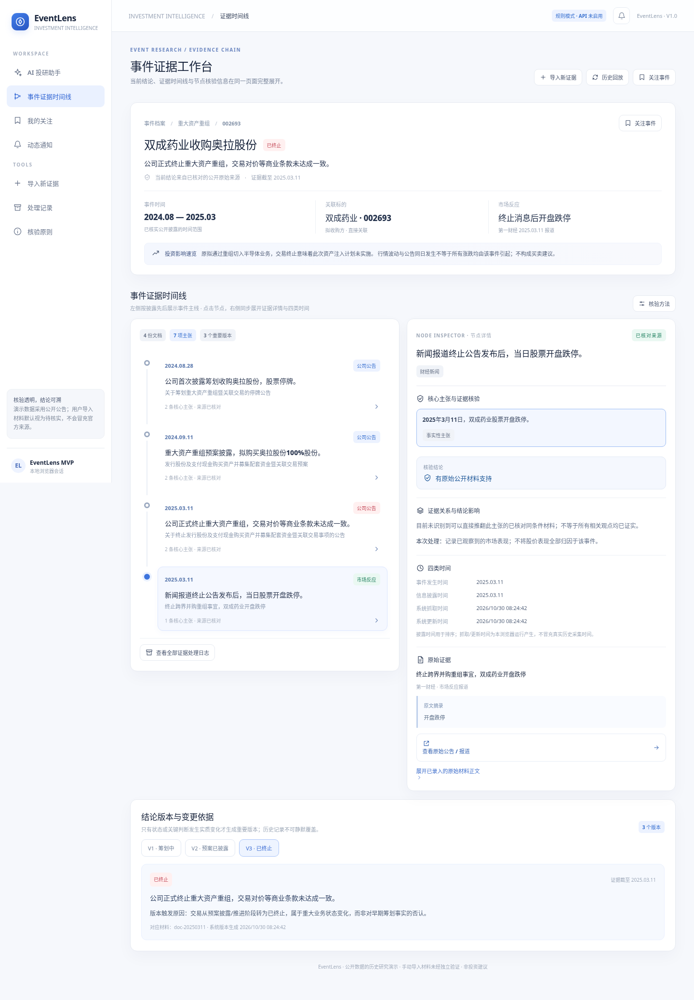

# EventLens · 投资事件情报与证据时间线

> 让持续演化的投资事件有迹可循，让每一项结论都有据可查。

**在线体验：** https://event-lens.netlify.app  
**源代码：** https://github.com/lh121020100-eng/EventLens  
**项目类型：** AI 投研产品设计与工程验证 · 可交互 MVP

## 项目概述

同一投资事件可能先后出现筹划公告、交易预案、媒体报道、进展更新与终止公告。碎片化信息容易让投资者混淆**最初来源、最新状态、事实与推测**，也难以判断新材料是否真正改变了已有结论。

EventLens 以**事件**而非单篇新闻为分析单位，将公开材料关联到同一事项，提取可核查的主张，组织证据关系，并将重要变化呈现为可追溯的事件时间线与结论版本。

当前 MVP 以**双成药业（002693）收购奥拉股份**的历史交易为演示案例，重点验证从材料输入到证据组织、结论更新和用户通知的核心交互。

## 核心体验

- **事件问答入口：** 输入与案例相关的问题，获得事件摘要、当前状态和来源入口。
- **单页证据时间线：** 左侧按时间展示重要节点，右侧查看选中节点的主张、核验结论、原文与来源链接。
- **信息类型区分：** 对事实性主张、观点、推测和传闻分别标记；信息类型不等于事实真实性。
- **证据与冲突处理：** 区分支持、否认和限定性材料；重复转载不作为独立证据叠加。
- **结论版本演化：** 重要进展或终止触发新的事件版本；一般重复报道只记入处理记录。
- **材料导入与历史回放：** 可粘贴材料并观察规则分析结果；可重演历史披露顺序。
- **关注与站内通知：** 对关注的事件展示重要状态变化提醒（保存在当前浏览器）。

### 界面预览



## 产品逻辑与技术实现

```text
用户提问 / 导入材料
         ↓
文档记录与时间标准化
         ↓
事件匹配（主体、交易对象、事项连续性）
         ↓
原子主张提取与类型标记
         ↓
证据关系判断与内部质量评估
         ↓
事件状态更新 / 重要结论版本
         ↓
摘要卡片、证据时间线、关注通知
```

| 模块 | 实现方式 |
|---|---|
| 前端 | HTML / CSS / JavaScript，响应式单页交互 |
| 事件分析 | `src/engine.js`，规则式匹配、主张处理、证据关系及版本逻辑 |
| 演示数据 | `src/data.js`，历史案例的结构化材料 |
| 状态保存 | 浏览器 `localStorage`，无账户或跨设备同步 |
| 可选 AI 服务 | `netlify/functions/`，预留 DeepSeek 服务端调用及响应校验 |
| 测试 | Node.js 内置测试运行器，`tests/` |

**证据质量评分仅在内部辅助判断，前端不展示分数或权重。** 用户看到的是核验结论、必要的判断依据和原始材料链接。内部启发式分数不代表主张为真的统计概率。

## AI 的作用与当前能力边界

项目为模型辅助的投资事件分析设计了服务端调用链路：将材料交给 DeepSeek 进行结构化主张抽取，再由程序检查引文是否存在于输入原文中，最终由确定性规则决定能否更新事件状态。

**当前公开演示默认采用规则分析模式，未完成 DeepSeek 官方 API 的真实密钥调用验证。** 因此不能将演示中的自动抽取、核验或摘要表述为已由在线大模型实际完成。服务端代码已预留 `DEEPSEEK_API_KEY` 环境变量，但尚未作为已上线能力对外承诺。

本 MVP **不提供**实时金融资讯抓取、全市场事件搜索、iFinD / 扶摇数据接入、真实行情自动更新、投资建议或交易功能。手动粘贴的所谓“官方公告”不能仅凭用户填写的来源名称被认证为真实公告。

## 案例数据与溯源

演示案例为双成药业拟收购奥拉股份的历史事件。关键节点包括 2024 年 8 月筹划、2024 年 9 月预案披露，以及 2025 年 3 月宣布终止。**事件自然推进与终止不等同于同一时点的证据冲突。**

主要公开来源：

- [2024-08-28 筹划重大资产重组公告（巨潮资讯）](https://static.cninfo.com.cn/finalpage/2024-08-28/1221008773.PDF)
- [2024-09-11 重大资产重组预案（深圳证券交易所）](https://disc.static.szse.cn/disc/disk03/finalpage/2024-09-11/314a7506-08bb-4afa-9c82-38dc4564d9fa.PDF)
- [2025-03-11 终止重组公告（巨潮资讯）](https://static.cninfo.com.cn/finalpage/2025-03-11/1222760531.pdf)

案例中使用经过整理的结构化材料与摘要，并非直接从在线 PDF 实时抽取的完整正文。历史系统抓取时间不作伪造；导入时间由用户实际操作产生。任何合成的异常或冲突测试材料仅用于测试，不应被理解为真实新闻。

## 本地运行

需要 Python 3；运行自动化测试需要 Node.js 20+。

```bash
python3 -m http.server 4173
```

浏览器访问 `http://localhost:4173`。运行测试：

```bash
npm test
```

如需启用服务端 DeepSeek 调用，需要在支持 Netlify Functions 的部署环境中配置 `DEEPSEEK_API_KEY`。**密钥仅能保存在服务端环境变量中，不能提交到仓库或写入浏览器代码。** 未配置密钥时，前端应继续明确显示规则模式。

## 验证与文档

- [`docs/TEST_REPORT.md`](docs/TEST_REPORT.md)：主链路、异常输入、证据边界与合规测试。
- [`docs/AI_USAGE_AND_VALIDATION.md`](docs/AI_USAGE_AND_VALIDATION.md)：AI 在需求分析、编码、测试中的使用及验证记录。
- [`docs/DEMO_SCRIPT.md`](docs/DEMO_SCRIPT.md)：演示流程参考。
- [`docs/EventLens_PRD_v1.pdf`](docs/EventLens_PRD_v1.pdf)：产品需求文档。

## 已知限制

1. 目前聚焦单一真实历史案例，不代表已支持全市场事件识别。
2. 规则式主张提取与冲突识别有边界，复杂跨文档推理仍需模型与人工验证。
3. 导入的正文及其 URL 未自动进行远程内容一致性校验，未经核实材料不得覆盖已核查的公开披露。
4. 关注、版本回放和通知保存在当前浏览器；无服务器端账户、持久化数据库或自动后台监控。
5. 当前线上版本是否启用服务端函数取决于实际部署方式；不能仅因仓库存在函数代码便视为 DeepSeek 已上线。
6. 产品用于研究辅助与信息溯源，不构成证券投资建议。

---

*EventLens · 投资事件情报与证据时间线 · MVP*
